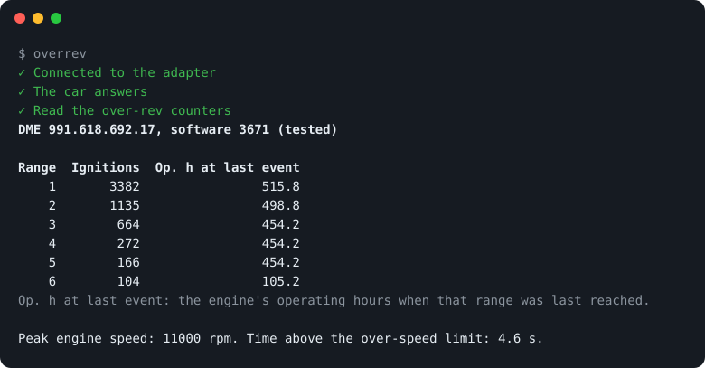

#  overrev

**See how many ignitions a Porsche 991.2 GT3 engine fired above the rev limit, and when. Read-only.**

[](https://github.com/YannKr/porsche-overrev/actions/workflows/tests.yml)
[](LICENSE)
[](#hardware)
[](#read-only-by-design)

The engine computer (DME) counts every ignition above the rev limit, in six
ranges. overrev reads those counters through an OBDLink adapter, with the
engine hours when each range was last reached, the highest rpm on record and
the stored fault codes. The over-rev numbers are the ones PIWIS shows,
without a dealer visit.

<p align="center"></p>

> **Tested on one car only: a 2018 Porsche 991.2 GT3, US market**
> (PIWIS vehicle `GT3_991II_USA`, DME part number 991.618.692.17, DME
> software 3671). Other models, markets or DME software versions can use
> different identifiers or scales. `overrev read` says whether the DME it
> found is the tested one. In automatic mode, the tool also flags any other
> VIN (**OTHER CAR**) and any untested DME (**UNTESTED DME**). Use it at your
> own risk.

## Pick a way

You need an OBDLink adapter (tested with the MX+), with the ignition on and
the engine off. macOS, Windows and SocketCAN interfaces: see
[Platforms](#platforms).

###  On your phone, no code


1. On the phone, download [overrev-pids.udpid](https://yannkr.github.io/porsche-overrev/overrev-pids.udpid).
2. In the OBDLink app: **Settings › User-Defined PIDs › ⋮ › Import**. This replaces PIDs you added yourself, so export those first.
3. Connect to the car and open **PID Values**.

[More](#phone-no-code-obdlink-app)

###  In the browser, nothing to install


Open **[yannkr.github.io/porsche-overrev](https://yannkr.github.io/porsche-overrev/)** in Chrome or Edge on a computer and click **Connect**.
[More](#browser-page-desktop-chrome-or-edge)

###  In a terminal, on a Raspberry Pi or Linux


```bash
curl -fsSL https://raw.githubusercontent.com/YannKr/porsche-overrev/main/get.sh | sh
```

Installs `overrev` in your home directory, pairs the OBDLink and reads the car.
After that, just run `overrev`. [More](#install)

###  Every time the Pi starts


```bash
curl -fsSL https://raw.githubusercontent.com/YannKr/porsche-overrev/main/get.sh | sh -s -- --auto
```

A Raspberry Pi in the car reads once per boot and posts the result to Discord
or ntfy. [More](#automatic-mode-linux)

## What the numbers mean

| You see | It means |
|---|---|
| Ranges 1 to 6 | All six are above the rev limit. Range 1 is the lowest engine speed, range 6 the highest. |
| Ignitions | Each cylinder firing counts once. At 9,000 rpm the engine fires 450 times a second, so 450 ignitions add up to about one second. |
| Op. h at last event | The engine's operating hours when that range was last reached. It is not a duration. Ranges with the same hours were most likely reached in one event. overrev cannot read the current total hours yet, so it cannot say how long ago that was. |
| Peak engine speed | The highest rpm the engine computer has on record. It can be well above the rev limit, for example after a missed downshift. |
| Time above the over-speed limit | In seconds: all the time the engine has spent above the engine computer's over-speed limit, added up. |

In the OBDLink app, the same values are called **Over-rev 1 ignitions**,
**Over-rev 1 last event (op h)** and so on.

## What it reads

The DME counts every ignition at an engine speed above the rev limit, in six
over-rev ranges. PIWIS shows these as `EngPrt_nrIgnNMax1..6` (number of
ignitions) and `EngPrt_tiNMax1..6` (engine operating time at the most recent
over-rev in that range). This tool reads the same twelve values with an
OBDLink adapter or any SocketCAN interface. The numbers are the ones PIWIS
shows (the table gives the operating time in hours, PIWIS shows minutes, and
`--json` has the minutes). You can also read them with no code at all, in the
OBDLink phone app.

On the test car, the live read matched a PIWIS screen of the same day on all
twelve values.

| Range | Ignitions (DID) | Op. time at last over-rev (DID) |
|---|---|---|
| 1 | `1B68` | `1741` |
| 2 | `1B69` | `1743` |
| 3 | `1B6A` | `1745` |
| 4 | `1BBB` | `1BB8` |
| 5 | `1BBC` | `1BB9` |
| 6 | `1BBD` | `1BBA` |

- Each value is one UDS `22 <DID>` read from the DME (CAN, 11-bit, 500 kbps,
  request `7E0`, response `7E8`). The answer is a 16-bit big-endian word.
- Ignitions: the raw word is the count.
- Operating time: the raw word is in tenths of an operating hour. Raw × 6 is
  the value in minutes that PIWIS shows. Raw ÷ 10 is hours.
- The time value is not a duration. It is the engine operating-time stamp of
  the most recent over-rev in that range. Ranges that one rev excursion swept
  through at the same time have the same stamp.

It also reads the DME's all-time peak record and its stored fault codes:

| Value | Request | Scale |
|---|---|---|
| Highest engine speed ever (`EngPrt_nMaxSpd`) | `22 1B8A` | raw ÷ 2 = rpm |
| Total time above the over-speed limit (`EngPrt_tiOverSpd`) | `22 1B8B` | raw ÷ 5 = seconds |
| Stored fault codes | `19 02 2C` | 3-byte codes with status (active, confirmed, pending, stored) |

The fault codes are shown as the DME reports them (6 hex digits). The tool
does not translate them into fault names.

Example (the test car, October 2026):

```
DME 991.618.692.17, software 3671 (tested)

Range  Ignitions  Op. h at last event
    1       3382                515.8
    2       1135                498.8
    3        664                454.2
    4        272                454.2
    5        166                454.2
    6        104                105.2
Op. h at last event: the engine's operating hours when that range was last reached.

Peak engine speed: 11000 rpm. Time above the over-speed limit: 4.6 s.
```

The stored fault codes follow, one per line. The first line names the DME and
says whether overrev was tested on it. Before it, `overrev read` shows its
steps (see [Using it](#using-it)).

## Read-only by design

The transport refuses to send anything other than `10 01`, `10 03`,
`22 <one DID>`, `3E 00` and `19 02 <mask>` (read stored fault codes). It
raises an error before transmit for anything else. The tool never sends
SecurityAccess (`27`), writes, routines, resets or clear-codes requests
(`14`). The browser page has the same list, in JavaScript.

No SecurityAccess is needed. On the test car, the DME answered all twelve
DIDs in the extended session (`10 03`). It also answered in the default
session: checked directly for `1B68` and `1741`, and the OBDLink phone app
reads all twelve as plain mode-22 PIDs.

## Hardware

| Option | Status |
|---|---|
| OBDLink MX+ over Bluetooth, Linux (Raspberry Pi), through `/dev/rfcomm0` | Tested live |
| OBDLink MX+ over Bluetooth, Linux, direct connection (plain `overrev`) | Not yet tested live |
| OBDLink MX+ app on iPhone, user-defined PIDs | Tested live |
| OBDLink app on Android | Same file format; not tested |
| An OBDLink adapter (Bluetooth or USB) in the [browser page](#browser-page-desktop-chrome-or-edge) | Not yet tested live |
| Any SocketCAN interface (CANable, USB2CAN, CAN HAT) | Tested offline only (python-can virtual bus); the SocketCAN path itself is untested |
| OBDLink MX+ on macOS (`/dev/cu.*`) | Not tested |
| OBDLink MX+ on Windows (COM port) | Not supported by the one-liner; manual use not tested |

## Platforms

| Platform | What works | Status |
|---|---|---|
| Linux (Raspberry Pi OS, any distribution with BlueZ) | The one-liner, automatic pairing, direct Bluetooth connection, automatic mode (`overrev setup-auto`, or a system service you install by hand) | Supported. The read through `/dev/rfcomm0`, as a system service on a Raspberry Pi, is tested live; the direct connection and `setup-auto` are not yet. |
| macOS | The one-liner installs. Pair the MX+ once in System Settings → Bluetooth (press its Connect button first). `overrev` then uses the serial port that macOS creates for it (`/dev/cu.OBDLink…`). No automatic pairing, no automatic mode. | Not tested with the adapter. The MX+ talks to Apple devices through Apple's accessory protocol, so it is not certain that macOS creates the serial port. |
| Windows | Not the one-liner (it is a shell script) and not the automatic pairing (it uses BlueZ). In principle: pair the MX+ in Windows Bluetooth settings (Windows creates an outgoing COM port), install with `pip install https://github.com/YannKr/porsche-overrev/archive/refs/heads/main.tar.gz`, then run `overrev read --elm COM5` (your COM port). | Not supported, not tested. |
| Desktop Chrome or Edge 117 or newer (Windows, macOS, Linux, ChromeOS) | The [browser page](#browser-page-desktop-chrome-or-edge): no install; Web Serial reaches a paired Bluetooth OBDLink or a USB one | Not yet tested with an adapter. Safari, Firefox and phone browsers cannot use it. |
| iPhone, Android | No code: the OBDLink app with the PID file, see [Phone](#phone-no-code-obdlink-app). | Tested on iPhone; Android not tested. |

## Install

```bash
curl -fsSL https://raw.githubusercontent.com/YannKr/porsche-overrev/main/get.sh | sh
```

One line on a Raspberry Pi or another Linux machine with Bluetooth: plug the
OBDLink MX+ into the car, turn the ignition on (engine off), and run it. It
installs `overrev` into `~/.local/share/overrev` (its own Python venv,
nothing system-wide), pairs the adapter the first time (press the MX+
**Connect** button when asked), and prints the over-rev counters, the peak
record and the stored fault codes. After that, just run `overrev`. Run the
line again to update. You can read [get.sh](get.sh) first. macOS, Windows and
phones: see [Platforms](#platforms).

Before it installs anything, the installer checks that it is not running as
root, that Python is 3.10 or newer with venv support, and (on Linux) that
BlueZ is installed and a Bluetooth adapter is present and on. Each install
goes into a fresh environment that must start before it replaces the old one,
so a failed update keeps the previous install working. It asks before it
contacts the car, and logs to `~/.local/share/overrev/install.log`.
Options go after `sh -s --`:

```bash
curl -fsSL https://raw.githubusercontent.com/YannKr/porsche-overrev/main/get.sh | sh -s -- --no-run     # install or update only
curl -fsSL https://raw.githubusercontent.com/YannKr/porsche-overrev/main/get.sh | sh -s -- --yes        # read without asking
curl -fsSL https://raw.githubusercontent.com/YannKr/porsche-overrev/main/get.sh | sh -s -- --uninstall
```

`OVERREV_REF=<tag or commit>` (set for `sh`) installs that version instead of
`main`.

Or run it once with [uv](https://docs.astral.sh/uv/), without installing it:

```bash
uvx --from https://github.com/YannKr/porsche-overrev/archive/main.tar.gz overrev
uvx --from https://github.com/YannKr/porsche-overrev/archive/main.tar.gz overrev read --json
uvx --from https://github.com/YannKr/porsche-overrev/archive/main.tar.gz overrev read --elm PORT
```

Put any arguments after `overrev`, as in the second and third lines. uv keeps
the download in its cache. To fetch the newest version, add `--refresh` right
after `uvx`:

```bash
uvx --refresh --from https://github.com/YannKr/porsche-overrev/archive/main.tar.gz overrev
```

`uvx` skips the installer's checks (BlueZ, a powered Bluetooth adapter, a
Python with Bluetooth sockets). If the connection fails, use the installer, or
give the adapter's serial port, as in the third line (`PORT` is for example
`/dev/rfcomm0`).

## Using it

```bash
overrev                    # find the OBDLink (pair it if needed) and print the table
overrev --json             # the same as JSON
overrev --mac <MAC>        # a specific adapter
overrev read --elm /dev/rfcomm0             # an adapter bound with rfcomm
sudo ip link set can0 up type can bitrate 500000
overrev read --channel can0                 # a SocketCAN interface instead
```

`overrev` connects to the adapter directly over Bluetooth (RFCOMM), with no
root and no `rfcomm bind`. If no OBDLink is paired yet, it asks you to press
the **Connect** button on the MX+ (the BT LED blinks fast; pairing mode lasts
2 minutes), then pairs and trusts it. This needs BlueZ (`bluetoothctl`),
which Raspberry Pi OS has.

### What you see

While it works, `overrev read` shows each step on its own line, with a tick
when it worked and a cross when it did not. The results follow on standard
output (see the example under [What it reads](#what-it-reads)).

```
✓ Connected to the adapter
✓ The car answers
✓ Read the over-rev counters
```

When a step fails, you get the cross, the error, and a `hint:` line that says
what to try next. `overrev` then exits with status 1.

```
✓ Connected to the adapter
✗ The car does not answer
error: adapter: CAN ERROR
hint: Turn the ignition on (engine off), wait a few seconds, then try again.
```

| Hint | What it means |
|---|---|
| The adapter is connected but does not respond. Unplug it for 10 seconds, plug it back in, then try again. | The Bluetooth link is up, but the adapter does not answer its setup commands. Unplugging it resets it. |
| Turn the ignition on (engine off), wait a few seconds, then try again. | The adapter works, but the engine computer does not answer. Usually the ignition is off. |
| The engine computer refused a diagnostic session. overrev is only tested on the 991.2 GT3 DME. | The engine computer answered, but said no. It is probably a different DME. |
| On the tested 991.2 GT3 these values answer without SecurityAccess, so a refusal suggests a different DME or software version. This tool never sends SecurityAccess. | The engine computer refused to give a counter. overrev does not try to unlock it. |
| The car stopped answering during the read. Keep the ignition on and try again. | The ignition went off, or the link dropped, in the middle of the read. |

Some errors have no hint because the error text already says what to do. A
terminal that cannot show the tick and the cross gets `ok` and `FAIL` instead.

### Save a report

```bash
overrev read --report report.html
```

also writes a one-page HTML report: the date, the VIN, the DME, the table, the
peak record and the stored fault codes. It is one file with no script and no
link to another file, so it opens offline and prints. You can give it to a
buyer or a mechanic. The VIN is in the report, so look at it before you post
the file in public. Without `--report`, `read` does not ask the car for the VIN.

### A car that is not tested

The first line of the results names the DME and says `(tested)` or
`(not tested)`. For a DME that is not the tested one, `overrev` also prints a
`note:` line to say that the values may not mean what the labels say. The
numbers are still shown. To help check them for your car, run

```bash
overrev probe
```

with the ignition on and the engine off (it takes `--mac` or `--elm` like
`read`). It asks the engine computer for its part number, software, hardware
numbers and variant, the raw answers for the counters and the peak record, and
how many fault codes are stored. It prints them as a Markdown report. It never
asks for the VIN or a serial number, so the report is safe to paste into a
public issue: https://github.com/YannKr/porsche-overrev/issues/new?template=new-car.yml

### JSON

`overrev --json` prints one JSON object with `dme`, `ranges`, `peak` and
`fault_codes`. The `dme` field says what was found and whether it is the
tested one:

```json
"dme": {
  "part_number": "99161869217",
  "software": "3671",
  "tested": true
}
```

`part_number` and `software` are `null` when the engine computer refuses them
or has nothing to give. `tested` is then `false`.

### From a checkout

From a checkout, two more read-only scripts (both find the adapter the same
way, or take a serial port as the last argument):

```bash
python3 -m venv .venv && .venv/bin/pip install -e '.[test]'
.venv/bin/python scripts/read_ident.py          # VIN, part numbers, software, engine code
.venv/bin/python scripts/scan_dids.py 1B00 1BFF # every DID in the range that answers
```

## Automatic mode (Linux)

`overrev auto` reads once per boot without user input. It retries every
30 s until the adapter and the car answer. Then it reads the VIN, the DME
identity, the twelve counters, the peak record and the stored fault codes,
appends one JSON record to `readings.jsonl`, and can post the result to a
Discord webhook or an ntfy topic. The post shows the ignitions added since the
previous read. If the VIN is not one you set with `--vin`, the read still
happens, but the post says **OTHER CAR**. If the DME is not the tested one, the
post says **UNTESTED DME**. Without `--vin`, no car counts as another. A post
that fails is tried three times, and it never makes the service read the car
again.

It takes the adapter as `--mac <MAC>` (a direct Bluetooth connection) or
`--elm <PORT>` (a serial port such as `/dev/rfcomm0`); one of the two is
required. The other options are `--vin` (repeat it for more than one car),
`--log-dir` (required), `--webhook-file` and `--retry`. `--webhook-file` names
a file that holds a Discord webhook URL or an ntfy topic URL (for example
`https://ntfy.sh/my-topic`). It must be an http or https URL. If it is not,
the service stops with an error before it reads the car, and systemd does not
restart it. If the file is missing or cannot be read, the service logs a
warning and reads the car without posting.

### One command: `overrev setup-auto`

For any Linux machine with systemd and Bluetooth. **Not yet tested live**: it
is covered by tests with fake adapters and a fake systemd, but it has not run
on a real Raspberry Pi with the car. The system service below is the tested
route.

```bash
overrev setup-auto
curl -fsSL https://raw.githubusercontent.com/YannKr/porsche-overrev/main/get.sh | sh -s -- --auto   # install overrev first, then the same
```

`setup-auto` needs the installed `overrev` from the one-line install, not
`uvx`, because it writes the program's path into the service.

Plug the OBDLink into the car and turn the ignition on (engine off). Then it:

1. Finds the paired OBDLink, or pairs one (press **Connect** on the MX+ when
   asked). `--mac <MAC>` picks a specific adapter.
2. Reads the car once, with the same steps as `overrev read`, to check that it
   works. It takes the VIN from the car.
3. Asks on the terminal for a Discord webhook or an ntfy topic URL. It must
   start with `https://`. Press Enter to post nothing, or, when one is saved
   already, to keep it. `--webhook URL` answers the question in advance. The
   URL is a secret: it is saved in `~/.config/overrev/webhook`, mode 600.
4. Writes the systemd user service `~/.config/systemd/user/overrev-auto.service`
   (with the VIN of this car, so another car is flagged), enables it and
   starts it. The first automatic read starts at once.
5. Turns on "linger", so the service runs at boot without a login. If that
   needs more rights, it prints the command to run once:
   `sudo loginctl enable-linger <user>`.

Logs: `~/.local/state/overrev/readings.jsonl` and `overrev.log`, or
`journalctl --user -u overrev-auto`. To read again without a reboot, run
`systemctl --user restart overrev-auto`.

Run `overrev setup-auto` again to change something: it rewrites the service
and restarts it, and keeps the saved webhook unless you give a new one.
To stop posting, delete `~/.config/overrev/webhook`; automatic reads continue
without posting.
`overrev setup-auto --remove` stops and removes the service. Your logs and
settings stay. `get.sh --uninstall` also removes the service.

`setup-auto` installs a service for your user. If the system-wide service from
the next section is also installed, it warns you, because both would read the
car at boot. Enable only one of the two (for example,
`sudo systemctl disable --now overrev-auto` for the system-wide one).

### By hand, as a system service (tested)

This is the route that has run on a Raspberry Pi with the car. That live run
used an earlier version of `overrev auto`, from before the DME identity line,
the ntfy option and the **OTHER CAR** and **UNTESTED DME** lines. The `19 02`
fault-code read is not yet verified live.

1. Pair the MX+ once: run `overrev` with the car on, or `deploy/pair-obdlink.sh`.
2. Create the configuration (it stays out of git, mode 600):

```bash
mkdir -p ~/.config/overrev && chmod 700 ~/.config/overrev
printf 'OVERREV_MAC=<adapter MAC>\nOVERREV_VIN=<your VIN>\n' > ~/.config/overrev/env
echo '<Discord webhook URL or ntfy topic URL>' > ~/.config/overrev/webhook
chmod 600 ~/.config/overrev/*
```

3. Install the service. Edit `User=` and the paths in
   `deploy/overrev-auto.service` first if your user is not `pi` or the
   checkout is not `~/overrev`:

```bash
sudo cp deploy/overrev-auto.service /etc/systemd/system/
sudo systemctl daemon-reload
sudo systemctl enable overrev-auto
```

To use it: power the Pi, plug in the MX+, turn the ignition on. To read again
without a reboot, run `sudo systemctl restart overrev-auto`.

Logs of this service:

- `~/overrev/log/readings.jsonl`: one record per read.
- `~/overrev/log/overrev.log`: everything, including each line to and from
  the adapter. It rotates at 1 MB and keeps 5 old files.
- `journalctl -u overrev-auto`.

## Browser page (desktop Chrome or Edge)

https://yannkr.github.io/porsche-overrev/ reads the counters in the browser,
with no install. Pair the OBDLink in your computer's Bluetooth settings (or
plug in a USB one), plug it into the car, turn the ignition on (engine off),
click **Connect** and choose the OBDLink in the list that the browser shows.
You get the same steps, hints, table, peak record and fault codes as in the
terminal.

- It needs Web Serial: Chrome or Edge 117 or newer on a computer. Safari,
  Firefox and phone browsers cannot reach the adapter.
- It only reads, with the same request list as the command line. It never
  asks for the VIN. The results stay in the browser: the page loads nothing
  from other sites and sends nothing anywhere.
- **Not yet tested with a real adapter.** The logic is tested against a fake
  OBDLink.
- The page is the `docs/` folder (`index.html`, `app.js`, `overrev.js`): no
  build step and no libraries.

## Phone, no code (OBDLink app)

The DIDs also answer in the default session, so the OBDLink app's
user-defined PIDs can read them. `deploy/obdlink/overrev-pids.udpid` holds
all twelve plus the two peak values, in the app's own export format: header
`ECM`, mode `22`, equation `A*256+B` for counts, `(A*256+B)/10` for hours,
`(A*256+B)/2` for the peak rpm and `(A*256+B)/5` for the over-speed seconds.

1. Get the file onto the phone (iCloud Drive, Files, mail).
2. In the app, go to **Settings → User-Defined PIDs → ⋮ → Import**. On the
   test iPhone, the import **replaced** the existing user-defined PIDs, so
   export yours first if you want to keep them.
3. Connect to the car and open **PID Values** to see all fourteen.

The phone app is not limited to reads. Its clear-codes buttons are outside
this tool's read-only guard.

On a computer, the [browser page](#browser-page-desktop-chrome-or-edge) does
the same read from desktop Chrome or Edge, which can reach a paired Bluetooth
serial device through Web Serial. iPhone browsers cannot reach the MX+, so on
a phone use the app.

## Known quirks (OBDLink MX+)

- **One connection at a time.** A phone that is paired with the MX+ and in
  range takes the adapter whenever it is free. The Pi then gets "Host is
  down". Turn off Bluetooth on the phone, or unpair the MX+ from it.
- **Fast reconnects fail.** A new connection less than about 5 s after a
  disconnect often fails. The first command on a new link can also be lost,
  so the transport retries `ATZ`.
- **The adapter sleeps.** A few minutes after the car is off, the MX+ goes
  to sleep and drops Bluetooth.
- **No passive check is possible.** The diagnostic CAN carries no traffic of
  its own, so the tool cannot tell a parked car from a running one before it
  sends. While the MX+ is still awake after switch-off, each retry puts one
  unanswered request on the bus.
- **Long answers.** Multi-frame answers with 10 or more frames have not been
  seen yet. Their line numbering is not verified.

## Tests

```bash
.venv/bin/python -m pytest
node --test tests/web/*.test.mjs     # the browser page; needs Node 18 or newer
```

Give `node --test` the file names, as above: a bare directory fails on new
Node versions. One of the browser tests also runs Python, to check that the
page and the command line use the same texts.

The suite checks the following:

- The read-only allowlist blocks requests before transmit.
- The decoder applies the scales, and the CLI reads, reports refusals and
  replays recorded CAN logs.
- The CAN transport, on python-can's virtual bus, refuses before transmit and
  times out cleanly when the DME is silent.
- The OBDLink transport works against a fake adapter that follows the
  ELM327 text protocol. This covers echo, prompt, response-pending,
  multi-frame answers and lost commands.
- The automatic mode handles retries, another car, an untested DME, DME
  refusals, and failed Discord or ntfy posts.
- Bluetooth: finding a paired OBDLink, pairing when none is, the socket
  wrapper, and the messages when the adapter is unreachable.
- The step lines, the hints (and the `ok`/`FAIL` fallback), the DME check, the
  HTML report (car text is escaped), and `overrev probe` (no VIN in its output).
- `setup-auto` (the service file, the webhook, running it twice, `--remove`)
  and the installer script, with stand-ins for the programs they call.
- The browser page: the same read-only list, the read against a fake OBDLink,
  a cancelled port picker, an error in the middle of a read, and car text
  that is shown as text and never as HTML.

## License

MIT, see `LICENSE`.

## Disclaimer

This is not affiliated with or endorsed by Porsche. PIWIS and OBDLink are
trademarks of their owners. Diagnostic requests go to a running vehicle
control unit. This tool only reads, but you are responsible for how and where
you use it.
